# Day-ahead vs imbalance in DK1: a guide

Every day at noon, tomorrow's electricity is sold in an auction. Whatever the auction gets wrong is corrected in real time, at a different price. I tested whether the gap between those two prices in western Denmark can be predicted a day ahead from public data.

With what I tried, it cannot. None of 17 strategies makes a profit that can be told apart from luck. What I did learn is that the profit sits in the error of the wind forecast, and that disagreement between weather models says something about that error at noon. On the three months I had locked away for a final test, the best of the 17 did not pass, though that test was too short to settle the matter.

| Hypothesis | What came out |
|---|---|
| 1. A strong wind forecast leaves the system short more often | True, weakly. It does not give a profit that can be told apart from luck. |
| 2. Heavy holiday traffic leaves the system short in the evening | No support. Households use more power on those days, but in the daytime. |
| 3. What works for buying should work in mirror image for selling | No support. Selling on calm forecasts lost money. |
| 4. The error of the wind forecast can be partly foreseen at noon | Half of it holds. How a forecast changed before noon says nothing about how it changes afterwards. Disagreement between weather models does predict the error, and the strategy built on it was the best of the 17 in development. It did not pass the final test on the holdout, which was too short to settle it. |

This guide is written for a reader who has not worked with power markets. Part 1 covers the market and the trade, and Part 2 the data and the method. Part 3 takes the hypotheses one at a time. Part 4 looks at all 17 strategies together, Part 5 reports the one test on the holdout, Part 6 says what the backtest leaves out, and Part 7 is the conclusion. A reference section at the end explains how to read the numbers and how the two kinds of model work.

The project was developed with heavy use of AI. The [README](README.md) says how, and it has the instructions for running the code.

## Contents

- [Part 1. The market and the trade](#part-1-the-market-and-the-trade)
- [Part 2. Data and method](#part-2-data-and-method)
- [Part 3. The hypotheses](#part-3-the-hypotheses)
- [Part 4. All 17 strategies together](#part-4-all-17-strategies-together)
- [Part 5. The holdout](#part-5-the-holdout)
- [Part 6. What the backtest leaves out](#part-6-what-the-backtest-leaves-out)
- [Part 7. Conclusion](#part-7-conclusion)
- [Reference](#reference)

## Part 1. The market and the trade

### The market in two steps

Electricity cannot be stored cheaply in bulk, so production and consumption have to match from one second to the next. The market gets there in two steps.

The first step is the day before. At 12:00, producers, consumers and traders hand in their bids for every period of the following day. The auction returns one price per period, the day-ahead price. Periods were hours until October 2025 and have been quarter-hours since.

The second step is on the day itself. No forecast is exactly right. The wind is weaker than expected, or a plant trips. Energinet, the Danish grid operator, makes up the difference by paying flexible plants to produce more or less. What that costs sets a second price for each quarter-hour, the imbalance price. Anyone who ended up delivering or using a different amount than they traded is settled at it.

### Words used in this guide

| Term | Meaning |
|---|---|
| DK1 | Western Denmark: Jutland and Funen. One of the two Danish price zones, with a lot of wind power. |
| MW and MWh | A megawatt is a rate, a megawatt-hour an amount. Holding 1 MW for a quarter-hour is 0.25 MWh. Prices are quoted in EUR per MWh. |
| Gate closure | The deadline for day-ahead bids, 12:00 Danish time on the day before delivery. |
| Short and long | The system is short when there is too little power and Energinet has to buy more. The imbalance price is then at or above day-ahead, and usually above it. Long is the reverse. In about one quarter-hour in ten the system is in balance. |
| Spread | Imbalance price minus day-ahead price. It is what the trade below earns per MWh. |
| Position | What a trader holds after a trade, here 1 MW bought or sold for one quarter-hour. In this trade a position cannot be closed early: there is no way out of it before delivery. |
| Edge | A real advantage, as opposed to luck: something that makes a strategy earn on average. |
| Backtest | Running a trading rule over past data as if it had been traded at the time, to see what it would have made. |
| Holdout | Data that is locked away and looked at once, at the end. Here it is delivery from 1 August 2026. Everything before that is the development data. Parts 1 to 4 use only the development data, and Part 5 reports the one look at the holdout. |
| ECMWF | The European Centre for Medium-Range Weather Forecasts. Its forecasts are the weather input of this project. |

### The trade

The trade I tested is the simplest one that bets on the imbalance. Buy 1 MW in the day-ahead auction for a quarter-hour, with no customer to use it. The power is surplus, and the surplus is settled at the imbalance price. Selling day-ahead without a plant to produce is the same bet in the other direction. The seller has promised power it does not have and buys the missing power at the imbalance price.

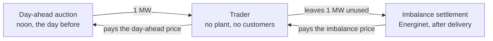

The profit per MWh is the imbalance price minus the day-ahead price. The buyer makes money when the system turns out short and loses when it turns out long.

Two quarter-hours from 3 January 2026 show both outcomes. At 10:45, day-ahead cost 87.85 EUR/MWh and the imbalance price was 300.00. On 0.25 MWh that is a profit of 53 EUR. At 00:00 the same day, day-ahead cost 82.98 and the imbalance price was 17.74, a loss of 16 EUR.

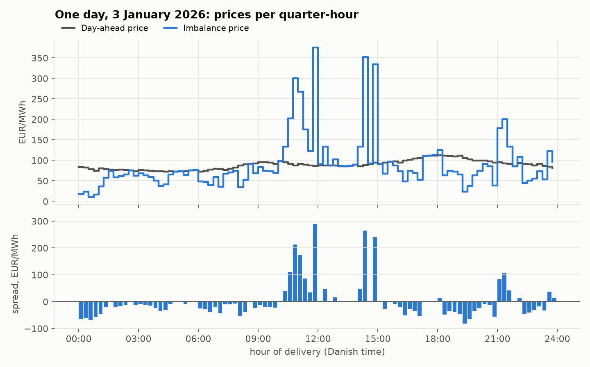

Buying 1 MW in all 96 quarter-hours of that day would have made 37 EUR. That came to 470 EUR won in 25 quarter-hours, 433 EUR lost in 58, and nothing in the 13 where the two prices were equal.

### Why it is hard: the spread is lopsided

That January day is typical. Over the sixteen months of development data the spread is negative in 56% of quarter-hours, exactly zero in 19% and positive in 25%. It is exactly zero when little or no balancing power was needed, because the imbalance price then equals the day-ahead price. The typical quarter-hour (the median) costs a buyer 11 EUR/MWh, and yet the average is a gain of 2 EUR/MWh, because the positive side has a very long tail. The largest spread in the data is 9,267 EUR/MWh.

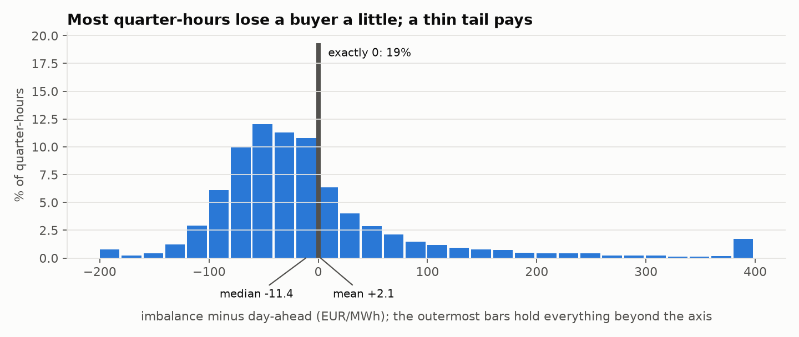

A handful of quarter-hours therefore decides whether buying pays. Take out the 46 largest of 45,688 and the average spread changes sign, from +2.1 to -1.2 EUR/MWh. A strategy can look profitable only because it happened to hold a position during three spikes, and most of the work in the project went into ruling that out. (These figures leave out the heavy-traffic days, which are kept for hypothesis 2.)

## Part 2. Data and method

### The data

Everything is public and free. The series start on 19 March 2025, when Energinet changed how the imbalance price is calculated. Its public series in the new form starts on that date, and earlier prices are not comparable. The development data runs to 31 July 2026, which is sixteen months and 47,996 quarter-hours. The first six months are only used for fitting. That leaves eleven test months, September 2025 to July 2026, with about 32,000 quarter-hours.

| What | Source | Resolution | Role |
|---|---|---|---|
| Imbalance price, and whether the system was short or long | Energinet, Energi Data Service | 15 minutes | What the trade is settled at |
| Day-ahead price | Energinet, Energi Data Service | Hourly, 15 minutes from October 2025 | What the trade is bought at |
| Energinet's wind forecasts: the day-ahead one and the latest | Energinet, Energi Data Service | Hourly | Testing what later information would be worth |
| Household consumption in the three DK1 regions | Energinet, Energi Data Service | Hourly | The consumption test for hypothesis 2 |
| ECMWF weather forecasts as they stood one and two days ahead | Open-Meteo, Previous Runs API | Hourly, at seven points across DK1's wind areas | The wind signal |
| Individual ECMWF forecast runs, and three other weather models | Open-Meteo, Single Runs and Previous Runs APIs | Hourly | Hypothesis 4 |
| Danish public holidays and school breaks | Calendar | Daily | The heavy-traffic days of hypothesis 2 |

### The one rule: nothing from the future

A backtest knows how every day ended. If even one input carries a trace of that, the result is fiction. So every input is checked against the moment the bid goes in.

| When | What happens | Known when bidding? |
|---|---|---|
| The days before | Earlier prices and imbalances, and the weather forecasts published so far | Yes |
| Day before delivery, 12:00 | Gate closure: bids for all of tomorrow are due | |
| Day before delivery, about 13:00 | Day-ahead prices are published | No |
| Day before delivery, 18:00 | Energinet publishes its wind forecast | No |
| Delivery day | 96 quarter-hours, each settled at its own imbalance price | No |

In practice this comes down to three rules.

1. Weather forecasts are the archived versions, as they stood at the time. The archive holds, for every hour, the forecast as it stood 24 hours before and as it stood 48 hours before. I count a forecast as available eight hours after it was made, to allow for the time it takes to compute and publish. Take delivery at 03:00. The forecast from 24 hours before was made at 03:00 the day before and counts as available at 11:00, before the gate, so it is used. For delivery at 05:00 it would only be available at 13:00, after the gate, so the forecast from 48 hours before is used. That holds for the rest of the day, and it is older than what a real trader has. The rule is not exact for ECMWF's two models, which Part 6 explains.
2. Past imbalance prices come only from days that had ended before the day of the bid. The day-ahead price of the bid day itself may be used, since it was published the day before.
3. The day-ahead price of the delivery day is never an input. It is the outcome of the auction being bid into.

The code has tests for these, including the days when the clocks change.

### The process

With a few spikes deciding the average, it is easy to find a rule that worked in the past by accident. The process is there to make that hard.

1. I set a holdout aside. The project was done in November 2026, so the data for it was already downloaded. It was kept out by the code: every script used in development filters it away, and I did not look at it until the final run.
2. I fixed the test before running it. For hypotheses 2, 3 and 4, the measures and the direction of each trade were written down before the first run, so the result could not steer the choices.
3. The test walks forward. Each test month is traded with thresholds and models fitted only on the six months before it, and then the window moves on a month.
4. Every result gets an interval that says how far it could have moved by chance.
5. I counted how many strategies I tried, and the best one is tested against that.
6. The holdout is opened once, when the method is fixed. Part 5 reports that run.

The window rolls instead of growing, because the market rules changed during the period and old data stops being representative.

| Test month | Fitted on |
|---|---|
| September 2025 | 19 March to August 2025 |
| October 2025 | April to September 2025 |
| ... | ... |
| July 2026 | January to June 2026 |
| August to October 2026 | The holdout, traded once at the end |

### How results are reported

Every strategy trades 1 MW, and its profit is given in EUR per MWh traded, before costs. "Right" is the share of trades that made money.

Each profit comes with a 95% interval, which says how far it could have moved by chance. To get it, I draw delivery days at random from the test, with repeats, so that some days count twice and others not at all, and recompute the profit. Doing that 5,000 times gives 5,000 profits, and the interval is the range that holds the middle 95% of them. If it includes zero, the profit cannot be told apart from luck.

A second measure, used in Parts 4 and 5, is the chance of luck: how often a strategy with no edge would do at least this well. It only asks about doing well, which makes it the looser of the two. A result can have a chance of luck of 3 in 100 and an interval that still just includes zero.

The strategies of hypotheses 1 and 3 are measured on the same quarter-hours, those where every model has all its inputs, so that their numbers can be compared. Those of hypothesis 4 need newer forecasts and are measured on the quarter-hours where these exist. A strategy's number therefore moves a little from table to table. The wind rule shows 4.07, 3.97 and 3.53 EUR/MWh in three of them, and each table says which quarter-hours it uses. That the number moves at all with a few per cent of the data is itself a sign of how noisy it is.

The reference section says more about [these measures](#reading-the-numbers) and explains [how the two kinds of model work](#the-two-kinds-of-model).

## Part 3. The hypotheses

A hypothesis here is a reason, stated in advance, why the imbalance price should end up on one side of the day-ahead price. It matters because of the spikes. Search 48,000 quarter-hours for patterns and some will always turn up, and most of them are accidents. A reason given beforehand can be proved wrong, which a pattern found afterwards cannot.

I asked three things of each one. It has to name a mechanism, a chain of cause and effect in the physical system. The signal has to be known at noon the day before. And there has to be a reason why the market might not have priced it in already. The last is the hardest, and it is where each of them is weakest.

### Hypothesis 1. A strong wind forecast leaves the system short more often

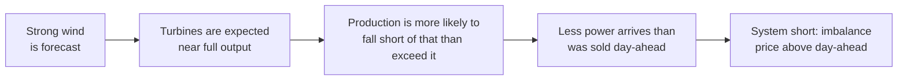

The middle step rests on a turbine not being able to produce more than its full output, so near that level the forecast can only be missed downwards. It could be wrong because everyone in the market knows how a turbine behaves. Wind producers can sell a little less than their forecast when it is high, and then the effect is already in the day-ahead price.

Before any money is involved, the hypothesis can be checked on the physics: how often is the system short at each level of forecast wind? The data agrees, weakly. The system is short in 28% of quarter-hours when the forecast is calmest and in 37% when it is windiest.

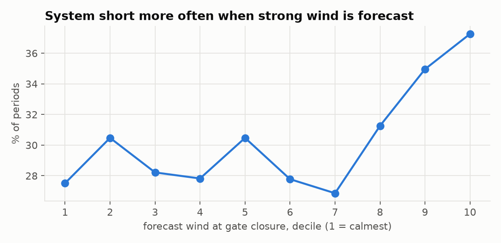

#### The strategies

Always buy is the benchmark. It buys in every quarter-hour and uses no information at all. A rule that earns no more than buying blindly has a signal that adds nothing.

The wind rule is the smallest test of the wind idea that I could think of. At the start of each month I take the wind forecast for every quarter-hour of the previous six months and find the level that only the windiest fifth exceeds. During the month, the rule buys whenever the forecast is above that level. It has one input and one threshold, and no model. The forecast is ECMWF's wind speed at 100 m at seven points across DK1, cubed and averaged, since a turbine's output grows roughly with the cube of wind speed. The speed is capped at 13 m/s, where a turbine reaches its full output.

Logistic regression asks whether more inputs help. The wind rule looks at one thing, and the hour, the sun or the imbalances of the last days may carry information too. The model predicts the probability of a short system from 13 inputs: the wind forecast in four forms, solar radiation, temperature, time of day, weekend, how the spread behaved two days earlier, and the age of the forecast. The strategy buys the fifth of quarter-hours with the highest probability.

Gradient boosting asks whether a more flexible model helps. It makes the same prediction from the same 13 inputs, and it can pick up thresholds and combinations that a weighted sum cannot.

Both models were also run with five more inputs: how fast the wind forecast changes from hour to hour, how sensitive production is to a small error in wind speed, how far the newest forecast has moved from the one before, how wrong Energinet's wind forecast was two days earlier, and the previous day's day-ahead price. A fast change, for example, is where a weather front arriving an hour late does the most damage.

#### What came out

| Strategy | Quarter-hours | EUR/MWh | 95% interval | Right |
|---|---|---|---|---|
| Always buy (benchmark) | 31,196 | +0.48 | [-2.61, 3.65] | 27% |
| Wind rule | 7,342 | +4.07 | [-1.44, 9.78] | 31% |
| Logistic regression | 9,653 | +1.08 | [-4.15, 6.53] | 30% |
| Gradient boosting | 8,308 | +0.13 | [-4.50, 4.83] | 29% |
| Logistic regression, five more inputs | 9,393 | +0.12 | [-5.16, 5.40] | 30% |
| Gradient boosting, five more inputs | 9,401 | +2.72 | [-2.44, 8.21] | 28% |

The direction of the hypothesis holds, weakly. The profit does not, since every interval includes zero. (Always buy shows 0.48 here, and the average spread in Part 1 was 2.1, because the eleven test months had a lower average spread than the whole sixteen.)

The wind rule is right in only 31% of its trades. It can still come out ahead because a win is larger than a loss: over the development data, a short quarter-hour pays a buyer about 111 EUR/MWh on average, and a long one costs about 53.

The models add nothing to it. Their skill at predicting a short system is 0.53 to 0.55 on a scale where 0.5 is a coin flip and 1 is perfect (the [AUC](#reading-the-numbers)), and the five extra inputs did not move it. The flexible model scored lower than the simple one, which points to a lack of signal in the inputs and not to the shape of the model.

The wind rule's own result depends on a choice I made by hand. The fifth was picked after seeing the chart above, and it is the most favourable of the six thresholds I later tried.

| The rule buys in the windiest | Quarter-hours | EUR/MWh | 95% interval |
|---|---|---|---|
| Half | 15,501 | -0.07 | [-4.19, 4.01] |
| 40% | 12,774 | +0.71 | [-3.99, 5.32] |
| 30% | 10,050 | +1.31 | [-3.80, 6.39] |
| Fifth (the wind rule) | 7,342 | +4.07 | [-1.44, 9.78] |
| Tenth | 4,283 | +1.35 | [-4.50, 7.31] |
| Twentieth | 2,535 | +0.42 | [-6.04, 7.04] |

A real effect of wind would keep growing as the rule becomes more selective. Here it peaks at the fifth and falls away on both sides, which is what a few spikes in one band of forecasts would look like.

The profits are fragile in a second way. Gradient boosting with its 13 inputs makes 266 EUR in total here. The comparison leaves out a few days on which an input of some other model is missing. With those days added back, the same model makes 8,285.

### Hypothesis 2. Heavy holiday traffic leaves the system short in the evening

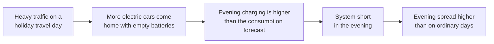

It could be wrong because electric cars are still a small part of consumption, many charge at night on a timer, and those who forecast consumption know the holiday calendar as well as I do.

I fixed 24 days from the calendar before looking at any prices: departure and return days around school holidays and long weekends. Each was compared with ordinary days on the same weekday within four weeks. Some comparison days are shared between two heavy-traffic days, which the intervals below do not allow for. The measure is the evening (17:00 to 23:00) minus the rest of the same day, so that a general holiday effect cancels out.

I ran the test twice. The hypothesis is a chain, and the price is its last and noisiest link, so I also tested the first link: what households in DK1 used on those days.

| Test | Smallest effect it could see | What it found | What that means |
|---|---|---|---|
| Evening spread | About 30 EUR/MWh | -13.9, interval -36.2 to 6.3 | Too weak to say anything |
| Household consumption | 3.0 percentage points | -4.1, interval -6.2 to -2.0 | Evidence against the first step |

The measure is the evening's rise against comparison days minus the rest of the day's rise, in EUR/MWh for the spread and in percentage points for consumption. The smallest effect a test could see is the one it would find four times out of five.

The price test could not have seen a realistic effect, and it rests on a few days: the typical day is 6.5 EUR/MWh above its comparison days while the average is 13.9 below. The consumption test could see one, and it found the opposite. Households use 7.0% more on these days outside the evening and 3.0% more in it, so the evening is the part of the day that rises least. On its own, 3% more in the evening would have looked like support.

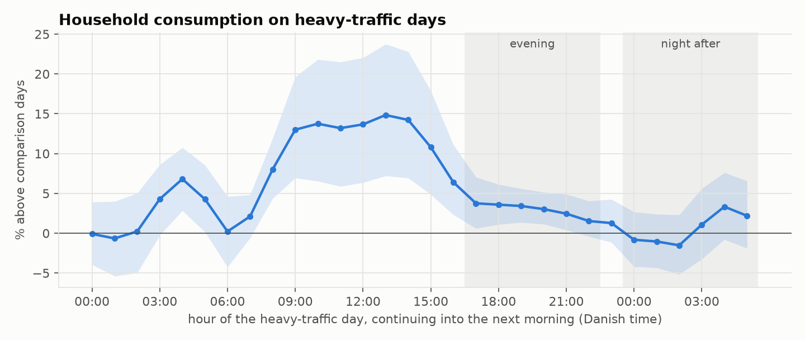

The extra use falls between 08:00 and 16:00, which is what a day off looks like: people are at home. Anyone who forecasts consumption can get that from the calendar, so there is little reason to expect it to surprise the imbalance price. The data has no consumption forecast to check that against.

Two things are outside the test. Consumption is 4 to 7% higher between 03:00 and 05:00 on the day itself, which would fit cars being charged overnight before departure, but I had not planned to test that and report it as an observation only. And charging at public chargers along the road counts as business consumption, which is not in the household series.

### Hypothesis 3. What works for buying should work in mirror image for selling

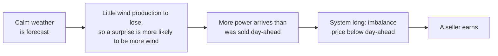

It could be wrong because the two sides are not symmetric. Over the development data, a seller collects about 53 EUR/MWh when the system is long and pays about 111 when it is short, and occasionally thousands.

#### The strategies

The wind rule that also sells is the wind rule plus its mirror image. It buys in the windiest fifth and sells in the calmest fifth. The system is long in most quarter-hours, so a strategy that only buys ignores the more common case.

The direction model puts probability and payoff together, because being right about the direction is not enough when the two sides pay differently. Gradient boosting predicts the chance of three outcomes: short, long or in balance. From these it works out an expected profit for a buyer, which is the chance of short times what a short quarter-hour pays on average, minus the chance of long times what a long one costs. The strategy buys where the expected profit is positive and sells where it is negative, in the fifth of quarter-hours where it is furthest from zero.

The same model with the position scaled trades in every quarter-hour, with a position between 0 and 1 MW in proportion to how large the expected profit is. A fixed threshold throws away how confident the model is, and scaling the position is the usual way to use that.

The spread regression predicts the number that is traded. Gradient boosting forecasts the spread itself in EUR/MWh, and the strategy trades in its direction in the fifth of quarter-hours where it is largest. The risk is that a few spikes dominate the fit.

#### What came out

| Strategy | Quarter-hours | EUR/MWh | 95% interval | Right |
|---|---|---|---|---|
| Wind rule that also sells | 13,889 | +1.39 | [-3.14, 5.66] | 40% |
| Direction model | 7,090 | +1.89 | [-3.60, 7.20] | 40% |
| Direction model, position scaled | 31,196 | +1.33 | [-1.96, 4.66] | 40% |
| Spread regression | 5,792 | +2.43 | [-3.20, 8.25] | 32% |

No support. The sell side of the wind rule lost 1.61 EUR/MWh on its own, and none of the four did better than the wind rule that only buys.

Selling also changes the risk, because a position in the imbalance cannot be closed early. The wind rule that also sells lost 976 EUR on 1 MW in its worst quarter-hour and 2,476 EUR on its worst day.

### The finding: the profit is in the forecast error

The most useful result of the project came out of a check. To see how much a leak of future information would flatter the wind rule, I ran it with fresher wind forecasts that could not have been used at noon. I expected fresher to be better. It was worse.

Alongside it I ran one strategy that trades on the forecast error itself, which I call the forecast revision strategy. Energinet publishes a wind forecast for DK1 at 18:00 the day before delivery and keeps updating it until shortly before delivery. The revision is the latest forecast minus the 18:00 one. If the forecast went up, more power arrives than the market sold, the system ends up long, and the strategy sells. If it went down, it buys. It trades only the largest fifth of the revisions.

| Wind signal | EUR/MWh | 95% interval | Right |
|---|---|---|---|
| The wind rule's own forecast, available at the gate | +3.97 | [-1.46, 10.02] | 32% |
| The wind rule on Energinet's forecast, published 18:00, six hours late | +0.95 | [-4.10, 6.24] | 31% |
| The wind rule on Energinet's latest forecast, minutes before delivery | -4.97 | [-10.15, 0.40] | 28% |
| The forecast revision strategy | +12.86 | [7.54, 18.06] | 56% |

This table uses the quarter-hours for which Energinet's forecasts exist.

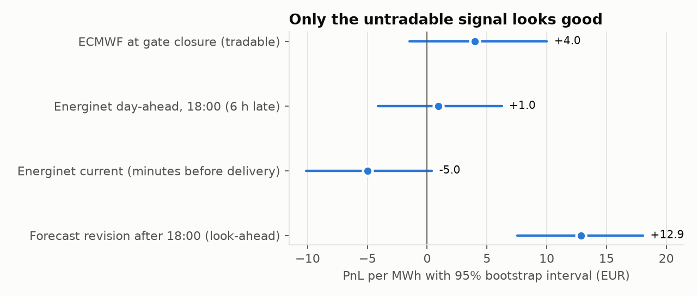

The first three rows are the wind rule with later and later forecasts. It earns when an early forecast of strong wind turns out too high, so that production falls short of what the market planned for. A fresher forecast has less of that error left in it. With the latest forecast, the rule buys when the wind really is strong, and the system is then more often long than short.

The revision strategy is the only one whose interval stays clear of zero in development, and it cannot be traded. The day-ahead position is taken at 12:00, and the revision only exists hours later. What it gives is a yardstick: this is roughly what knowing the forecast error in advance is worth with a rule this simple.

It also shows what a real edge looks like over time. The wind rule made 7,463 EUR on 1 MW over the 325 days of the comparison. Its five best days made 7,171 EUR of that, and the other 320 days together made 292. The revision strategy made 21,329 EUR and climbs most weeks.

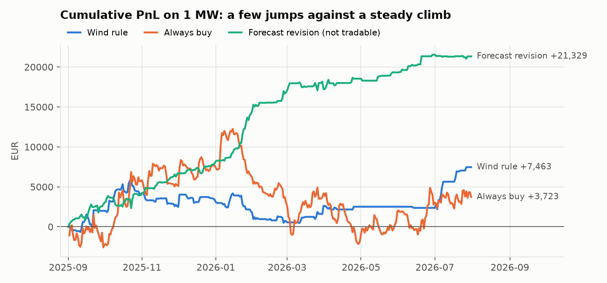

So the question a tradable strategy has to answer is narrower than the one I started with: at noon, which way will the wind forecast be wrong tomorrow?

### Hypothesis 4. The error of the wind forecast can be partly foreseen at noon

The hypothesis has two halves, one for each thing known at noon that might say something about the error.

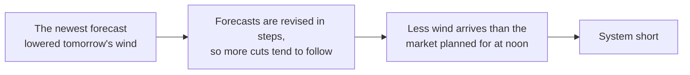

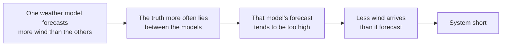

It could be wrong because a weather model that could foresee its own revisions would already have made them, and because the market sees the same forecasts that I do.

The first half uses the same kind of signal as the forecast revision strategy, but one that is known before the gate. ECMWF starts a new forecast every six hours, and each one is archived as it was issued. I use those from midnight and from midday.

| | The revision strategy above | The version that can be traded |
|---|---|---|
| The two forecasts compared | Energinet's 18:00 forecast and its latest | ECMWF's forecast from midnight before the bid and the one 12 hours earlier |
| Known at 12:00 gate closure? | No | Yes |
| Result | +12.86 EUR/MWh, interval 7.54 to 18.06 | +1.67 EUR/MWh, interval -4.93 to 8.41 |

The second half uses four weather models: ECMWF, ECMWF's AI model, the German ICON and the American GFS.

The strategies and the direction of each trade were written down in `forecasts.py` before the module was run for the first time.

#### The test on wind

Before any profit was counted, I checked both halves on wind itself. Energinet's revision after 18:00 stands in for the forecast error after the gate.

| Check | Correlation | 95% interval | Expected | Holds? |
|---|---|---|---|---|
| 12-hour revision before the gate against the revision after 18:00 | 0.05 | [-0.01, 0.11] | Positive | No |
| 24-hour revision before the gate against the revision after 18:00 | 0.04 | [-0.02, 0.09] | Positive | No |
| Disagreement between the models against the size of the later revision | 0.26 | [0.22, 0.31] | Positive | Yes |
| ECMWF minus the other models against the later revision | -0.26 | [-0.31, -0.20] | Negative | Yes |

A correlation runs from -1 to 1, and 0 means no relationship. 0.26 is weak by everyday standards, but with this much data it is clearly not zero. Disagreement is measured as the spread between the four models' forecasts for the same hour. Energinet's revision is alike from one day to the next, so these intervals are somewhat too narrow. Drawing blocks of 14 consecutive days widens the last one to [-0.34, -0.17] and leaves the others almost unchanged.

Revisions do not continue. How the forecast moved before noon says almost nothing about how it moves afterwards. Disagreement between the models does carry information, both about the size of the later error and about its direction.

#### The strategies

1. The wind rule on the newest ECMWF forecast, in place of the one made one or two days ahead. This is the forecast a trader has, so it shows whether the wind rule survives realistic information.
2. Betting that the revision continues, over 12 hours and over 24 hours: buy when the newest forecast lowered tomorrow's wind, since less wind is then expected to arrive, and sell when it raised it.
3. The wind rule traded only when the models disagree more than usual.
4. ECMWF against the other models: buy when ECMWF forecasts more wind than the other three, sell when it forecasts less, in the fifth of quarter-hours where the difference is largest.

#### What came out

| Strategy | Quarter-hours | EUR/MWh | 95% interval | Right |
|---|---|---|---|---|
| Wind rule on the older forecast, for comparison | 7,502 | +3.53 | [-2.01, 9.29] | 31% |
| Wind rule on the newest forecast | 7,586 | +2.43 | [-3.04, 7.97] | 31% |
| Revision continues, 12 hours | 6,263 | +1.67 | [-4.93, 8.41] | 43% |
| Revision continues, 24 hours | 6,536 | -0.18 | [-6.48, 6.12] | 43% |
| Wind rule when the models disagree | 5,051 | +3.13 | [-2.76, 9.34] | 29% |
| ECMWF against the other models | 6,667 | +5.17 | [-0.31, 10.27] | 53% |
| Logistic regression with the five new inputs | 9,812 | -0.69 | [-5.87, 4.58] | 29% |
| Gradient boosting with the five new inputs | 8,553 | +2.09 | [-2.65, 7.07] | 30% |

This table uses the quarter-hours where the newer forecasts exist, which is why the wind rule shows 3.53 in its first row.

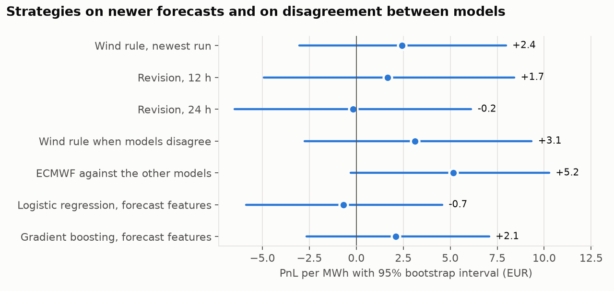

The first half fails. The premise did not hold on wind, and neither revision strategy earns anything.

The wind rule gets weaker with realistic information. On the forecast a trader has, it makes 2.43 EUR/MWh against 3.53 on the older one. That fits the finding above that it lives off the error in an early forecast, and it weakens hypothesis 1 further. The two forecasts also differ in resolution, 9 km against about 25 km, so the comparison is not only about how old the forecast is. Trading it only when the models disagree did not help either, and the two models of hypothesis 1 gained no skill from the new inputs.

ECMWF against the other models is the one result worth attention. It is the best of all 17 strategies, and its profit is built differently from the wind rule's. The wind rule lives off a few large wins: without its largest 0.1% of quarter-hours it falls from 4.07 to 1.44 EUR/MWh. For this strategy the largest quarter-hours are all losses, and without them it would make 7.62. Without its largest gains instead, which is the fair comparison, it still makes 4.23. That is the profile of a seller, who collects small amounts often and pays for the spikes. It is a different risk and not a smaller one. Its interval still includes zero, if only just, so it is not evidence yet.

#### ECMWF against the other models, in full

Since this is the one candidate, it deserves a closer look.

For each quarter-hour I take the wind forecast from ECMWF and from the three other models, all turned into the same measure of production. Each is taken the way the wind rule takes its forecast, which for most of the day means the forecast made two days ahead. The signal is ECMWF's value minus the average of the other three. Each month I find the size that only the largest fifth of differences exceeded in the previous six months. When the difference is larger than that, the strategy buys if ECMWF is the higher one and sells if it is the lower one.

The reasoning is that the truth more often lies between the models than at one end. If ECMWF forecasts less wind than the others, more wind is likely to arrive than ECMWF said. If the day-ahead market leaned on ECMWF, it sold too little wind, the system ends up long, and a seller earns.

In practice the strategy does one thing, because ECMWF forecasts less wind than two of the other models as a rule.

| Model | Average forecast, wind speed cubed |
|---|---|
| ECMWF | 682 |
| ECMWF's AI model | 676 |
| ICON | 808 |
| GFS | 842 |

The measure is wind speed in metres per second, cubed, and ICON and GFS run about a fifth higher than ECMWF. ECMWF is below the average of the others in 74% of all quarter-hours and in 91% of those with the largest differences. The strategy made 6,155 sells and 512 buys. What it tests is therefore narrower than its description: sell when ICON and GFS forecast much more wind than ECMWF.

That changes how to read its numbers. Being right 53% of the time is not skill, since selling in every quarter-hour of the test months is right 52% of the time. The gain is in the average. Its sell side makes 5.14 EUR/MWh where selling in every quarter-hour loses about 0.5.

Four cautions apply.

1. Part of the signal is the permanent gap between the models, and not disagreement about tomorrow. A cleaner version would first remove each model's usual level. That would be a new strategy, thought of after seeing this result, so it needs fresh data to count.
2. A gap that grows with the wind is largest when the wind is strong, so the strategy may partly be selling at certain wind levels. I have not separated the two.
3. The reasoning needs the day-ahead market to lean on ECMWF. I have no evidence for that beyond the result itself.
4. Selling carries the tail. Its worst quarter-hour lost close to 1,000 EUR on 1 MW, as it did for the wind rule that also sells, and the position cannot be closed early.

This is the strategy that was taken to the holdout, in Part 5.

There is also a route outside the day-ahead market for the revision idea. The intraday market stays open until shortly before delivery, so a revision can be known before that trade is made. It needs intraday prices, which this project does not have.

## Part 4. All 17 strategies together

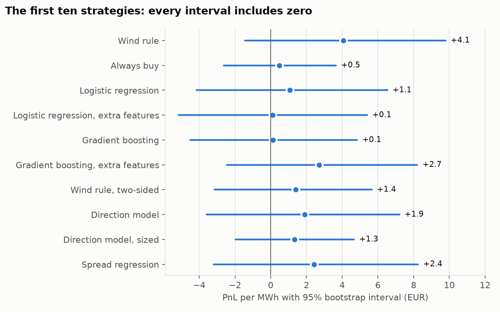

The figure shows the ten strategies of hypotheses 1 and 3, and the seven of hypothesis 4 are in the figure in that section. Every interval includes zero.

The table lists all 17 with their chance of luck. "Alone" is how often a strategy with no edge would do at least this well if it were the only one tried. "As one of 17" asks how often the best of 17 such strategies would do this well, since the best of many lucky draws looks better than one.

| # | Strategy | Hypothesis | Alone | As one of 17 |
|---|---|---|---|---|
| 1 | Always buy (benchmark) | 1 | 39 in 100 | 98 in 100 |
| 2 | Wind rule | 1 | 7 in 100 | 54 in 100 |
| 3 | Logistic regression | 1 | 35 in 100 | 97 in 100 |
| 4 | Gradient boosting | 1 | 48 in 100 | 100 in 100 |
| 5 | Logistic regression, five more inputs | 1 | 48 in 100 | 100 in 100 |
| 6 | Gradient boosting, five more inputs | 1 | 15 in 100 | 78 in 100 |
| 7 | Wind rule that also sells | 3 | 29 in 100 | 93 in 100 |
| 8 | Direction model | 3 | 24 in 100 | 91 in 100 |
| 9 | Direction model, position scaled | 3 | 21 in 100 | 88 in 100 |
| 10 | Spread regression | 3 | 20 in 100 | 87 in 100 |
| 11 | Wind rule on the newest forecast | 4 | 19 in 100 | 84 in 100 |
| 12 | Revision continues, 12 hours | 4 | 30 in 100 | 96 in 100 |
| 13 | Revision continues, 24 hours | 4 | 52 in 100 | 100 in 100 |
| 14 | Wind rule when the models disagree | 4 | 15 in 100 | 78 in 100 |
| 15 | ECMWF against the other models | 4 | 3 in 100 | 25 in 100 |
| 16 | Logistic regression with the five new inputs | 4 | 59 in 100 | 100 in 100 |
| 17 | Gradient boosting with the five new inputs | 4 | 19 in 100 | 85 in 100 |

The best of the 17 is ECMWF against the other models. Tested alone, it would have passed a test at the usual 5% level. As the best of 17 it is far from that, at 25 in 100. None of this is evidence, and the correction does not even count the threshold I picked by hand for the wind rule. The forecast revision strategy is not in the list, because it cannot be traded.

In the order I tried them, the strategies ask whether any signal beats blind buying, whether combining inputs helps, whether a more flexible model helps, whether better inputs help, whether trading both sides helps, whether weighting by payoff helps, and whether newer forecasts or other weather models help. Each answer is no until the last one, and Part 5 puts that one to the test on the holdout.

## Part 5. The holdout

Delivery from 1 August to 31 October 2026 was kept out of everything above. The data was on disk from the start, and the code filtered it away. I used it once, for one question: does the best strategy from development still earn on data it has never seen?

### What was fixed in advance

The test was written in `holdout.py` before the holdout was read.

1. One primary test. ECMWF against the other models, unchanged, passes if its chance of luck is below 5 in 100.
2. Two secondary tests: the wind rule, and the heavy-traffic test of hypothesis 2 with the holdout's four travel days added.
3. The other strategies are shown for description only, with no conclusion drawn from them.
4. Delivery from November 2026 is not looked at, and is left for a later test.

I also worked out beforehand how much the test could show. Three months is 92 days, and on that many days the uncertainty on the daily profit is about as large as the profit seen in development. If the effect is real and as large as there, the test passes about one time in four. So the way to read the outcome was fixed as well: a pass is strong evidence, a loss counts against the strategy, and a profit that does not pass is inconclusive.

A check after the run showed that the first of these was too generous. For a strategy that mostly sells, the losses come as a few large days, and on 92 days those are often simply absent. In a simulation with no edge at all, such a strategy passes this test about 25 times in 100, where it should be 5. A pass would have been weaker evidence than I wrote down. The strategy did not pass, so nothing rests on it.

### What came out

| ECMWF against the other models | Development | Holdout |
|---|---|---|
| Days | 333 | 92 |
| Quarter-hours traded | 6,667 | 2,440 |
| EUR/MWh | +5.17 | +1.23 |
| 95% interval | [-0.31, 10.27] | [-9.35, 12.20] |
| Total on 1 MW | +8,609 EUR | +752 EUR |
| Chance of luck, tested alone | 3 in 100 | 41 in 100 |

The strategy did not pass. It made a small profit that cannot be told apart from zero, which by the rule above is inconclusive.

A closer look does not help it, though this is description and not a test. In development the gain was on the sell side, which made 5.14 EUR/MWh where selling blindly lost about 0.5. On the holdout the sell side made -1.15 where selling blindly made -1.36, so its advantage shrank from 5.6 to 0.2 EUR/MWh. The small profit came from 216 buys on 11 days.

The weather half of the hypothesis held up a second time. On the holdout, ECMWF's distance from the other models has a correlation of -0.23 with Energinet's later revision (interval [-0.35, -0.11]), and disagreement between the models has a correlation of 0.22 with its size (interval [0.12, 0.33]). Disagreement between the models does say something about the forecast error. It did not turn into a day-ahead profit.

One check came out differently from development. On the holdout the 24-hour revision before the gate has a correlation of 0.15 with the later revision (interval [0.01, 0.27]), where it was 0.04 in development. That would mean revisions do continue, but the strategy built on it lost 9.72 EUR/MWh on the holdout, so it did not turn into a profit either. With one check of six behaving differently on three months, I read it as noise.

| Secondary test | Result on the holdout | Verdict |
|---|---|---|
| Wind rule | +3.96 EUR/MWh, interval [-6.64, 15.97], chance of luck 22 in 100 | Does not pass, inconclusive |
| Heavy-traffic days, now 28 with the holdout's four | -7.9 EUR/MWh, interval [-29.7, 11.5] | Still no support |

Of the 15 other strategies, two have an interval on the holdout that excludes zero, one above it and one below. With 15 intervals at 95%, about one would do that by chance, so I draw nothing from either.

### Was the holdout large enough?

No. On 92 days, the test could only be relied on to find an effect of 13.4 EUR/MWh, where "relied on" means four chances in five of passing. That is two and a half times what the strategy made in development, and about what the forecast revision strategy makes with information from the future. The development test was too small as well. On its 333 days it could be relied on to find 6.8 EUR/MWh, which is more than the 5.17 it showed.

| If the true effect is | Days of untouched data needed |
|---|---|
| As large as in development | 577 to 1,080 (1.6 to 3 years) |
| Half as large | 2,300 to 4,300 (6 to 12 years) |

The range depends on whether profit varies from day to day as it did in development or as it did on the holdout. Three months could confirm a large edge or expose a loss. It could not tell a modest edge from none, and a modest edge is the realistic case for the best of 17.

### What the holdout shows

The drop from 5.17 to 1.23 EUR/MWh is what choosing the best of 17 leads one to expect. The winner's result contains the luck that made it the winner, and new data does not repeat that luck. The holdout does not show that the strategy is worthless, since its interval still holds the development estimate.

The printed output of the run is in [results/holdout_2026-08_to_2026-10.txt](results/holdout_2026-08_to_2026-10.txt). Two notes on reading it. It lists the wind rule twice, as the secondary test and again among the other strategies on slightly different quarter-hours. And it shows no interval for the buy side of the primary strategy, because the buys fell on only 11 days and my script could not compute an interval from that. Computed afterwards, it is [-18.5, 90.6] EUR/MWh.

## Part 6. What the backtest leaves out

1. I have not checked whether the trade is allowed. Every trader acts through a balance responsible party, a company that answers financially for the difference between what was traded and what was delivered. In the Nordic market such a party has an obligation "to continuously plan for and achieve balance" ([Nordic Imbalance Settlement Handbook](https://www.esett.com/app/uploads/2026/06/NBS-Handbook-v5.4.pdf), eSett), with the requirements set by Energinet. Holding an imbalance on purpose may not fit with that. I treat this as a study of how two prices relate.
2. Fees on imbalances are not included. At 5 EUR/MWh the wind rule loses money even on its own numbers.
3. A 1 MW position is assumed not to move either price.
4. Eleven test months is little when a few spikes decide the outcome, and the market rules changed twice in the data: a rule from June 2025 under which a need for balancing power below 25 MW is rounded down to zero ([eSett, Q2 2025](https://www.esett.com/news/nordic-electricity-market-q2-2025/)), which falls in the months used for fitting, and quarter-hourly day-ahead prices in October 2025.
5. One input uses a little information from after the gate. The weather archive stores ECMWF's forecasts every three hours, and every six hours for its AI model, and fills the hours between with a smooth curve through the stored values on both sides. Those can come from different forecasts, so an in-between hour can carry weight from a forecast that started after the one my rule allows. A review of the code found this by rebuilding the values from single forecasts. For the AI model, which feeds the comparison between weather models, it matters in two or three early-morning hours a day. For the wind rule's own forecast it is a few per cent in two hours, and ICON and GFS are stored hourly and are not affected. On the development data it did not help the best strategy. ECMWF against the other models makes 5.17 EUR/MWh as reported, 5.71 without the hours most affected, 6.60 without every affected hour, and 5.40 when every model uses its two-day-old forecast all day. I did not measure it on the holdout.
6. For most of the day, the strategies of hypotheses 1 to 3 see a weather forecast a day older than the one a trader has, and so does the comparison between weather models in hypothesis 4. Hypothesis 4 also ran the wind rule on the newer forecast, and it did worse.
7. The models for a month are fitted on all data up to the start of that month. For delivery on the 1st, the bid is placed at noon the day before, when that afternoon had not happened yet. That is about 48 of 17,500 quarter-hours in the fit, for one day a month, and only for the strategies that fit a model. The rules with a threshold use no outcomes at all.
8. In September 2025, the first test month, day-ahead was still traded in whole hours, while the strategies pick single quarter-hours. That month's trades could not have been placed exactly as tested.
9. The imbalance prices from two days before, which the models use as inputs, are the final ones, downloaded afterwards. At the time only preliminary values existed, and I do not know how far they were revised. On the 25-hour day in October, four quarter-hours also get a day-ahead price from the same day as an input.
10. The tests are small. Neither the eleven months of development data nor the three months of the holdout could confirm an edge of the size seen, as Part 5 sets out. Delivery from November 2026 has not been looked at and can serve as a further test.

## Part 7. Conclusion

Can the gap between the day-ahead price and the imbalance price in DK1 be predicted a day ahead from public data? Not with anything I tried. Of 17 strategies, none earns a profit that can be told apart from luck, in eleven months of development data or on the three months held back.

That answer has to be read together with how much the tests could show. A spread that is decided by a few spikes is very noisy. With the data that exists, an edge of 5 EUR/MWh could not have been proved for the best strategy: the development test could be relied on to find 6.8 EUR/MWh, and the holdout 13.4. For the wind rule the figures are much the same. Settling whether the best strategy works would take 1.6 to 3 years of untouched data. What I have shown is that these signals hold no large and obvious edge. A small one may exist, and it has not been shown.

Two findings do stand. They are about the weather and not about profit, and they are far less noisy.

1. The profit is in the error of the wind forecast. A strategy that knows how the forecast will be revised earns 12.86 EUR/MWh with an interval clear of zero, and nothing known at noon came close to that.
2. Disagreement between weather models predicts that error, both its size and its direction, on the development data and again on the holdout.

The step that failed is turning the second finding into a day-ahead profit. The intraday market, where a forecast revision is known before the trade is made, is the natural place to try next.

## Reference

### Reading the numbers

Profit is in EUR per MWh traded. A quarter-hour at 1 MW is 0.25 MWh, so a spread of 100 EUR/MWh is 25 EUR.

The 95% interval is described in Part 2. Whole days are drawn, and not single quarter-hours, because quarter-hours within a day move together. For the wind rule, drawing blocks of 7 consecutive days widens the interval by 6% and blocks of 28 days by 22%, which does not change how it reads.

The chance of luck is computed on the profit per day. Tested alone, it is what statisticians call a one-sided p-value. The figure "as one of 17" asks how often the best of all 17 would do this well if none of them had an edge. The method is a studentised version of White's reality check.

AUC measures how well a model ranks cases. Pick one quarter-hour that turned out short and one that did not, at random. AUC is the chance that the model gave the short one the higher probability. A coin flip scores 0.5 and a perfect ranking scores 1. I use it because profit is decided by a few spikes and is noisy, while AUC counts every quarter-hour equally and is far more precise.

The comparison of the first ten strategies comes from `two_sided.py`, which measures them on the same quarter-hours. The scripts for single strategies each use every quarter-hour their own inputs allow, so `backtest.py` reports 3.48 EUR/MWh for the wind rule where this guide says 4.07.

### The two kinds of model

Logistic regression predicts a probability by adding up weighted inputs. Each input gets a weight, the weighted inputs are summed, and the sum is squeezed into the range 0 to 1 by an S-shaped curve. A positive weight on wind means that more wind makes a short system more likely. The model assumes that every input pushes in one direction, at one rate, whatever the other inputs are. With 13 inputs it has 14 adjustable numbers, so it is hard to overfit and easy to read.

Gradient boosting builds its prediction out of many small decision trees. A tree asks a few yes or no questions about the inputs, such as "is forecast wind above 9 m/s?", and ends in a number. The first tree makes a crude prediction. The next one is fitted to the errors of the first, and a small fraction of its correction is added. This repeats up to 200 times. The result can express that wind matters more in the evening, or only above a certain level. The price is thousands of adjustable numbers, which fit noise more easily.

Both models are refitted at the start of every month on the previous six months.
